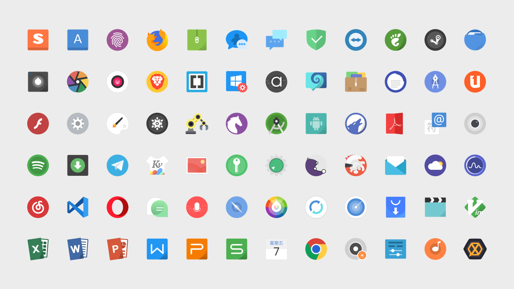
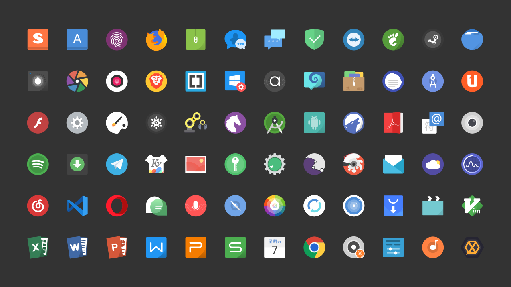

# Tela Icon Theme Fixed

A fork of the **Tela Icon Theme** that aims to fix various bugs found in the original project.

---

<p align="center">
  
  
</p>

---

## 📌 About This Repository

This repository is a fork of the original **Tela Icon Theme**. Its main goal is to fix several visual and functional issues identified over time, while keeping the look and structure of the original theme intact.

The original project continues to be actively developed; this fork focuses on bug fixes and small compatibility improvements.

> **Note:** All credit for the original design, structure, and source files of the theme goes to the original developer, **vinceliuice**.

---

## ✨ What's Different in This Fork?

* 🐛 Fixes for several known visual/functional bugs
* 🔧 Minor improvements and compatibility updates

---

## 🔗 Credits & References

* **Original GitHub Repository:** [vinceliuice/tela-icon-theme](https://github.com/vinceliuice/tela-icon-theme)
* **This Fork:** [satellaos-official/tela-icon-theme-fixed](https://github.com/satellaos-official/tela-icon-theme-fixed)

---

## 🎨 Available Color Variants

| Variant    | Description                      |
|------------|----------------------------------|
| `standard` | Standard color folder version (default) |
| `black`    | Black color folder version       |
| `blue`     | Blue color folder version        |
| `brown`    | Brown color folder version       |
| `green`    | Green color folder version       |
| `grey`     | Grey color folder version        |
| `orange`   | Orange color folder version      |
| `pink`     | Pink color folder version        |
| `purple`   | Purple color folder version      |
| `red`      | Red color folder version         |
| `yellow`   | Yellow color folder version      |
| `manjaro`  | Manjaro default color folder version |
| `ubuntu`   | Ubuntu default color folder version  |
| `dracula`  | Dracula default color folder version |
| `nord`     | Nord color folder version        |

Every selected color is installed in three flavors: the regular theme, a `-light` flavor and a `-dark` flavor (for example `Tela-blue`, `Tela-blue-light` and `Tela-blue-dark`).

---

## 📦 Manual Installation

### 1. Clone the repository

```bash
git clone --depth 1 https://github.com/satellaos-official/tela-icon-theme-fixed.git "$HOME/tela-icon-theme-fixed"
```

### 2. Run the installer

The installation location depends on how you run the script:

| Run as       | Destination directory          |
|--------------|--------------------------------|
| Regular user | `~/.local/share/icons`         |
| Root (`sudo`) | `/usr/share/icons`            |

**Install the standard color (current user only):**

```bash
bash "$HOME/tela-icon-theme-fixed/install.sh"
```

**Install the standard color (system-wide):**

```bash
sudo bash "$HOME/tela-icon-theme-fixed/install.sh"
```

**Install one or more specific colors:**

```bash
bash "$HOME/tela-icon-theme-fixed/install.sh" blue
bash "$HOME/tela-icon-theme-fixed/install.sh" red green nord
```

**Install all color variants:**

```bash
bash "$HOME/tela-icon-theme-fixed/install.sh" -a
```

**Install all color variants system-wide:**

```bash
sudo bash "$HOME/tela-icon-theme-fixed/install.sh" -a
```

**Install to a custom directory:**

```bash
bash "$HOME/tela-icon-theme-fixed/install.sh" -d /path/to/icons blue
```

**Install with a custom theme name:**

```bash
bash "$HOME/tela-icon-theme-fixed/install.sh" -n MyIcons blue
```

> ⚠️ **Important:** In this installer, `-u` (and `-r`) means **uninstall**, not "install for user". For a per-user installation simply run the script without `sudo`.

---

## 🗑️ Uninstallation

Remove all installed Tela variants for the current user:

```bash
bash "$HOME/tela-icon-theme-fixed/install.sh" -u
```

Remove all installed Tela variants system-wide:

```bash
sudo bash "$HOME/tela-icon-theme-fixed/install.sh" -u
```

If you installed with a custom name or directory, pass the same options when uninstalling:

```bash
bash "$HOME/tela-icon-theme-fixed/install.sh" -u -n MyIcons -d /path/to/icons
```

---

## ⚙️ Usage Reference

```
Usage: install.sh [OPTION] | [COLOR VARIANTS]...

OPTIONS:
  -a                       Install all color folder versions
  -c                       Install plasma colorscheme folder version
  -d DIR                   Specify theme destination directory (Default: $HOME/.local/share/icons)
  -n NAME                  Specify theme name (Default: Tela)
  -r, -u                   Remove/uninstall icon themes (Default: all)
  -h                       Show this help

COLOR VARIANTS:
  standard, black, blue, brown, green, grey, orange, pink, purple,
  red, yellow, manjaro, ubuntu, dracula, nord

  By default, only the standard one is selected.
```

---

## 🖥️ Applying the Theme

After installation, select the theme in your desktop environment's appearance settings (for example *Settings → Appearance → Icons* on XFCE, GNOME Tweaks, or KDE System Settings). Installed theme names look like `Tela`, `Tela-blue`, `Tela-blue-dark`, and so on.

---

## 📄 License

This project is licensed under the same terms as the original Tela Icon Theme. See the original repository for details.